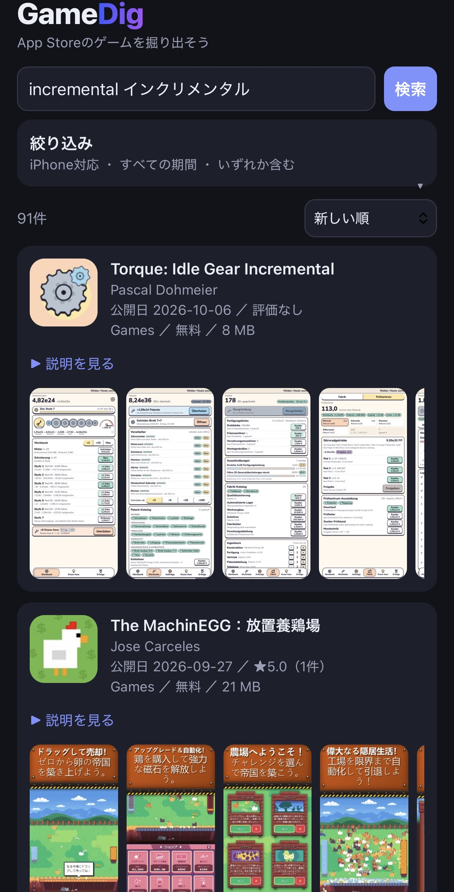

# GameDig

GameDigは、App Storeのゲームをスマホで手軽に掘り出せるWebページです。新作だけでなく、全期間からも探せます。iPhoneのSafariで動きます。

**[ページを開く](https://gamedig-app.github.io/GameDig/)**

  

## できること

- キーワードでゲームを検索（ゲーム名・説明文・開発者名から探す。空欄ならゲーム全般から探す）
- 次の条件で絞り込み（「絞り込み」をタップすると開きます）
  - ジャンル（ロールプレイング、パズル、アクションなど）
  - 対応端末（iPhone / iPad）
  - 公開日（7日・30日・90日・1年以内、すべての期間）
  - 無料のゲームだけ
  - キーワードが複数あるときの一致方法（いずれかを含む / すべてを含む）
- 並び替え（公開が新しい順 / 更新が新しい順 / 関連度順 / 評価が高い順 / 評価数が多い順）
- 開発者名、評価、容量、価格を一覧で確認
- 開発者名をタップすると、その開発者のゲームを全部表示（「← 戻る」で元の検索結果に戻れます）
- 結果は50件ずつ表示し、「もっと見る」で続きを表示
- 検索条件がURLに保存され、ブックマークやホーム画面から、同じ検索結果をすぐ開ける
- 最近の検索キーワードを5件まで記憶（タップで再検索）
- 長い結果から、一番上へ戻るボタン
- 「説明を見る」で説明文を確認
- スクリーンショットを横にスワイプして確認
- タップするとApp Storeのページを開く

## 使い方

1. キーワードを入力する（空欄でもOK）
2. 「検索」を押す
3. 「絞り込み」や並び替えで、条件を変えて見比べる

キーワードはスペースで区切って、複数入れられます。複数のときの一致方法は、「絞り込み」で選べます。

- **いずれかを含む**（最初の設定）: どれか1つでも書かれていれば表示します。言い換えや表記ゆれに向いています（例：`incremental インクリメンタル`）。
- **すべてを含む**: 全部の言葉が書かれているものだけに絞ります。条件を重ねたいときに向いています（例：`オフライン 協力プレイ`）。

開発者名をタップして開いたゲーム一覧には、絞り込み（ジャンル・対応端末・公開日・無料のみ）はかかりません。その開発者のゲームを、全部見られます。

絞り込みと並び替えは、検索結果の中からすぐに切り替わります。再検索が必要なのは、キーワードを変えたときだけです。

新作を探すときは、公開日を「7日以内」や「30日以内」にして、並び替えを「新しい順」にします。古いゲームも含めて探すときは、「すべての期間」にして、「関連度順」にすると探しやすくなります。

Safariの共有ボタンから「ホーム画面に追加」を選ぶと、アプリのように起動できます。検索したあとに追加すると、その検索条件のまま保存されるので、よく使う検索（例：キーワード「放置」＋「無料のみ」）を、ワンタップで開けます。

「最近の検索」は、使っているスマホのブラウザの中だけに保存されます。外に送られることはありません。

## 仕組み

Appleが公開している [iTunes Search API](https://performance-partners.apple.com/search-api) を使っています。このAPIには新着順で取得する機能がないため、キーワードごとに検索し、ゲームだけを残したうえで、公開日などの条件をこのページ側で絞り込んでいます。

## 注意

- 取得できるのは、キーワード1つにつき上位200件までです。すべてのゲームを網羅できるわけではないので、見つからないときは、キーワードを変えたり、絞り込みを緩めたりしてください。
- 新作は評価がまだ付いていないことが多く、評価順では下に並びます。
- 表示される情報はAppleのAPIから取得したもので、内容の正確さは保証できません。
- GameDigは非公式のサイトで、Apple Inc.とは無関係です。App Store、iPhoneはApple Inc.の商標です。

## ファイル構成

| ファイル | 内容 |
| --- | --- |
| `index.html` | ページ本体（HTML・CSS・JavaScriptを1ファイルにまとめています） |
| `README.md` | この説明 |
| `icon-180.png` / `icon-512.png` | ホーム画面用のアイコン |
| `ogp.png` | URLを共有したときに表示される画像 |
| `IMG_1093.jpeg` | この説明に載せている、画面のスクリーンショット |